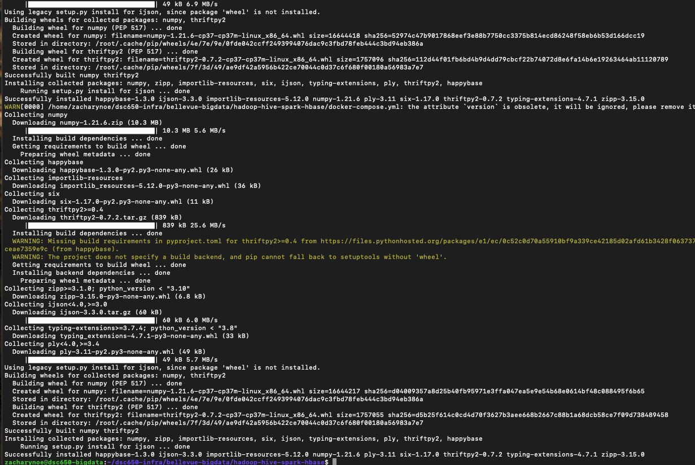
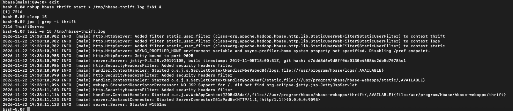

# Project Summary

## Overview

For this project, I built a pipeline that predicts which warehouse orders are going to be delivered late. The data starts as a CSV on GitHub, NiFi pulls it into HDFS, Hive gives it a schema, Spark MLlib trains and evaluates two classification models, and the model metrics get stored in HBase.

**Source Data → NiFi → HDFS → Hive → Spark MLlib → HBase**

The Spark job is submitted through YARN, so it runs on the worker containers instead of just on the master. Everything runs in the course's Docker setup (master, worker1 and worker2) on a Google Cloud VM with 8 CPUs and 16 GB of RAM.

Each tool has its own job. NiFi moves the file, HDFS stores it, Hive makes it queryable with SQL, Spark does the modeling, YARN manages where Spark runs, and HBase keeps a history of the model results.

## Dataset

**File:** `warehouse_orders.csv`  
**Raw GitHub URL:** https://raw.githubusercontent.com/NoeZach/warehouse-late-shipment-pipeline/main/sample-data/warehouse_orders.csv

The dataset has 3,000 outbound orders from 2025, shipped from four warehouses by five parcel and freight carriers, with 16 columns covering the order, how it shipped, peak season and inventory shortage flags, and whether it was late. About 30% of the orders are late. I generated it myself with [`generate_orders.py`](../sample-data/generate_orders.py) and built in patterns I see in warehouse work, like tight delivery promises on long routes, one warehouse struggling during peak season, and freight delays on long hauls, plus some randomness. It has a clear yes/no outcome and a mix of text and number columns, which makes it a good fit for classification, and at about 235 KB it's small enough for the VM.

## Environment Setup

There were two setup steps needed to connect Spark to HBase.

First, I installed `numpy` and `happybase` with `pip3` on the master, worker1 and worker2 containers. `numpy` is needed by Spark's ML library, and `happybase` is the Python library that talks to HBase. It has to be on the workers too, not just the master, because the HBase writes happen inside `foreachPartition`, which runs on the executors on the worker containers.

Second, I started the HBase Thrift server on the master with `nohup hbase thrift start &`. happybase can't connect to HBase directly, so it goes through the Thrift server on port 9090. Without it, the Spark job trains the models fine but fails when it tries to write to HBase.

### Package installation

### HBase Thrift server

## What Worked

Every stage of the pipeline ran from start to finish. NiFi downloaded the CSV and wrote it to `/project/raw` in HDFS, Hive loaded all 3,000 rows into the managed table, the Spark job ran on YARN and trained and evaluated both models, and the metrics were written to HBase and showed up in the final scan.

## Issues and Challenges

**The CSV header showed up in Spark.** Hive's row count was 3,000, but Spark found one extra row with `order_id` set to the text `order_id` and nulls everywhere else. After comparing the counts and looking at that row, I figured out that Spark doesn't use Hive's `skip.header.line.count` setting, even though Hive does. I kept the setting for Hive and added a filter in `processing.py` to drop the header row. The takeaway for me was that two tools sharing the same table don't always read it the same way, so it's worth checking counts in each one.

**The first models barely caught any late orders.** Before I added class weights, both models had decent accuracy but missed most of the late orders. Since only about a third of the orders are late, predicting "on time" for almost everything still looks pretty accurate. The confusion matrices made this obvious, so I added a weight column that gives late orders more importance during training. That's also why I report late precision and late recall, not just accuracy.

**LOAD DATA moved the file.** After loading Hive, `/project/raw` was empty, and at first I thought the NiFi file got lost. It turns out `LOAD DATA INPATH` moves the file into Hive's warehouse folder instead of copying it. So I had to take the HDFS screenshot before running the Hive load.

**NiFi kept downloading the file.** The template runs InvokeHTTP every 60 seconds, and PutHDFS fails if the file already exists, so the second download ended up in the failure queue. I switched to Run Once so only one copy was written, and then stopped NiFi before moving on, since the VM doesn't have enough memory to run everything at once.

**The executors couldn't find my helper file.** Splitting the code into two files meant the workers needed `processing.py` too. Adding `--py-files processing.py` to `spark-submit` fixed it.

## Results

The data made it all the way from a GitHub file to an HBase table, and each step was checked along the way with an HDFS listing, a Hive count, the Spark output and an HBase scan.

On the 853-row test set, Random Forest had an accuracy of 0.788, a weighted F1 of 0.786 and a ROC AUC of 0.814. Logistic Regression had an accuracy of 0.746 and a slightly higher ROC AUC of 0.826. Random Forest was more precise when it flagged an order as late (0.64 vs 0.54), while Logistic Regression caught more of the late orders (0.74 vs 0.60 recall). So Random Forest is the better choice if you want fewer false alarms, and Logistic Regression is better if catching every late order matters more. The most important feature was `miles_per_promised_day`, one of the features I added, followed by distance and promised days, which matches the Hive aggregations showing tight promises on long routes as the main cause of late orders. More detail is in the [Spark README](../spark/README.md).

## Lessons Learned

The biggest thing I learned is that most of the problems in a pipeline like this happen between the tools, not inside them. Each tool worked fine by itself, but the issues came from handoffs, like a table setting Spark ignored, a Hive command that moved NiFi's file, and a Python package that had to be on machines the driver never touches. Checking each step on its own made those problems a lot easier to track down. I also learned that accuracy isn't always the right metric, and that managing resources on a small VM (like stopping NiFi before running Spark) is part of designing the pipeline.

## Production Considerations

If this were a real production system, I would change a few things:

- **Security:** use Kerberos for HDFS and Hive, require authentication on the Thrift server, and keep credentials in a secrets manager instead of config files.
- **Ingestion:** have NiFi pull new orders from the warehouse management system on a schedule into dated folders, instead of a one-time download of a static file.
- **Storage:** store the Hive table as Parquet or ORC, partitioned by month, so Spark only reads what it needs.
- **Automation:** schedule the Hive load and Spark training with something like Airflow instead of running them by hand.
- **Reliability:** run more than one NameNode and HBase RegionServer so there's no single point of failure.
- **Model management:** retrain on a schedule and only replace the current model if the new one scores better, which the HBase table already supports since every run is saved with its own row key.
