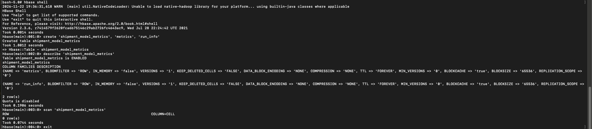
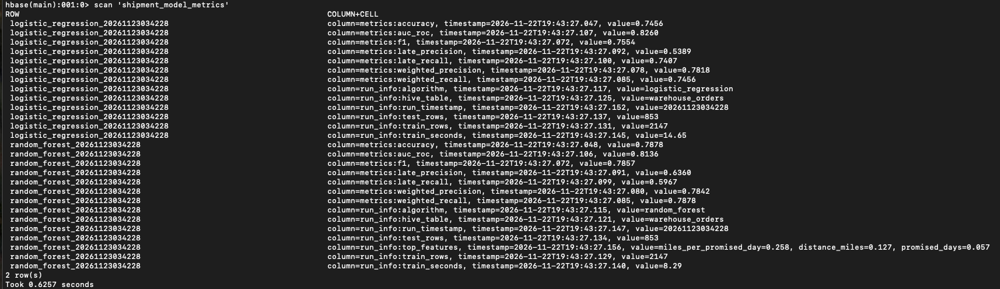

# HBase: Storing the Model Metrics

HBase is the last step in the pipeline. It stores the model metrics that Spark produces, so every training run is saved and can be looked up later.

## Table Design

**Table:** `shipment_model_metrics`  
**Row key:** `<model_name>_<timestamp>`, for example `random_forest_20261122153045`  
**Column families:** `metrics` and `run_info`

```
create 'shipment_model_metrics', 'metrics', 'run_info'
```

I put the model name first in the row key, so all the runs for one model are stored next to each other and I can pull them with a prefix scan like `scan 'shipment_model_metrics', {ROWPREFIXFILTER => 'random_forest'}`. The timestamp at the end means every run gets its own row instead of overwriting the last one, which makes it easy to compare runs.

I used two column families because the data falls into two groups. `metrics` has the numbers you'd compare (accuracy, F1, precision, recall, AUC), and `run_info` has the details about the run (algorithm, Hive table, row counts, training time, top features). Keeping them separate means a scan that only needs the scores doesn't have to read the descriptive info.

All the commands are in [`commands.txt`](commands.txt).

## Empty Scan

Before running Spark, I ran `describe` to confirm both column families existed and `scan` to show the table was empty (0 rows). This proves that anything in the table afterward came from the Spark job.



## Metrics Written by Spark

Each run writes two rows, one for `logistic_regression` and one for `random_forest`.

| Column | What it is |
|---|---|
| `metrics:accuracy` | share of test orders predicted correctly |
| `metrics:f1` | weighted F1 score |
| `metrics:weighted_precision` | weighted precision |
| `metrics:weighted_recall` | weighted recall |
| `metrics:late_precision` | of orders predicted late, how many were actually late |
| `metrics:late_recall` | of orders that were late, how many the model caught |
| `metrics:auc_roc` | area under the ROC curve |
| `run_info:algorithm` | which model the row is for |
| `run_info:hive_table` | the Hive table the data came from |
| `run_info:train_rows` / `test_rows` | how many rows went into training and testing |
| `run_info:train_seconds` | how long training took |
| `run_info:run_timestamp` | when the job ran |
| `run_info:top_features` | top 3 Random Forest features (Random Forest row only) |

## Populated Scan

After the Spark job finished, scanning the table showed two rows, `logistic_regression_20261123034228` and `random_forest_20261123034228`, with all the metrics and run info filled in. The values match what Spark printed, for example `metrics:accuracy` is 0.7878 for Random Forest and 0.7456 for Logistic Regression, and the Random Forest row's `run_info:top_features` lists `miles_per_promised_day`, `distance_miles` and `promised_days`. Since `run_info:hive_table` points to `warehouse_orders` and the train and test row counts (2,147 + 853) add up to the 3,000 rows loaded into Hive, this scan connects the final result back through every step of the pipeline.


