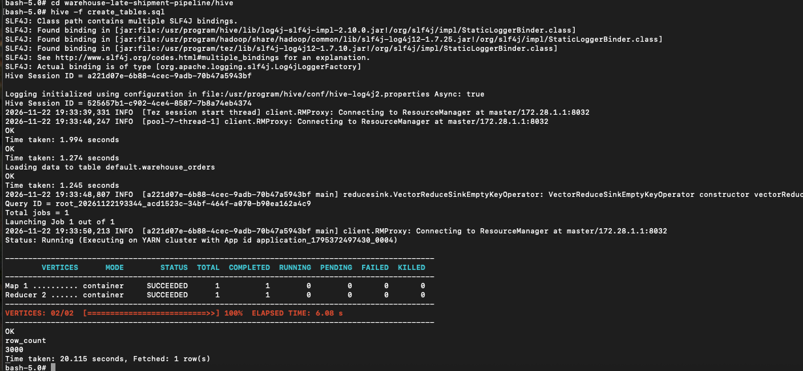
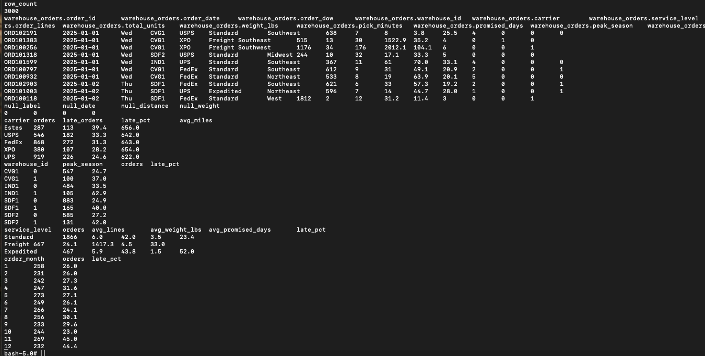

# Hive: Managed Table and Queries

Hive takes the CSV that NiFi wrote into HDFS and gives it a schema so I can query it with SQL. Spark also reads from this table, so it's the handoff point between storage and the machine learning step.

## Table Design

**Table:** `warehouse_orders` (in the `default` database)

I made one column for each field in the CSV and picked the types based on how each column gets used later:

- `order_date` is a `DATE` instead of a string so I can pull the month out of it, which is used for the monthly query and as a feature in Spark.
- Counts like `distance_miles`, `order_lines`, `total_units` and `promised_days` are `INT`, and measured values like `weight_lbs` and `pick_minutes` are `DOUBLE`.
- The flags `peak_season` and `inventory_short` and the label `is_late` are stored as `INT` 0/1. That way `AVG(is_late)` gives the late rate directly, and Spark can turn the label into a double without any extra work.
- The categorical columns (warehouse, carrier, service level, region, day of week) stay as `STRING` because Spark handles the encoding.

It's a managed table, so Hive owns the data files, and it's stored as a comma-delimited text file to match the CSV. I added `skip.header.line.count = 1` so Hive ignores the header row, and gave every column a comment so `DESCRIBE FORMATTED` explains the schema.

## SQL Files

- [`create_tables.sql`](create_tables.sql): creates the table and loads the file from `/project/raw`
- [`queries.sql`](queries.sql): row count, sample rows, null check and the aggregation queries

One thing I learned here is that `LOAD DATA INPATH` moves the file out of `/project/raw` and into Hive's warehouse folder rather than copying it, so the HDFS screenshot has to be taken before the load.

## Load Verification

After the load, `SELECT COUNT(*)` returned 3,000 rows, which matches the data rows in the CSV, so the header was skipped. The sample rows show every column filled in with the right types, and the null check came back as zeros.

## Query Results

The aggregation queries were mostly there to confirm the schema was right and to get a feel for the data before modeling. The late rate by carrier query shows the freight carrier Estes with the highest late rate and UPS with the lowest. Splitting by warehouse and season shows late rates jumping in November and December at every warehouse, especially IND1. The service level query shows Expedited orders are late more often than Standard ones, which makes sense since their promised window is so short. All of this told me `is_late` depends on things like carrier, location, season and how tight the delivery promise is, so it seemed like a good fit for a classification model.

