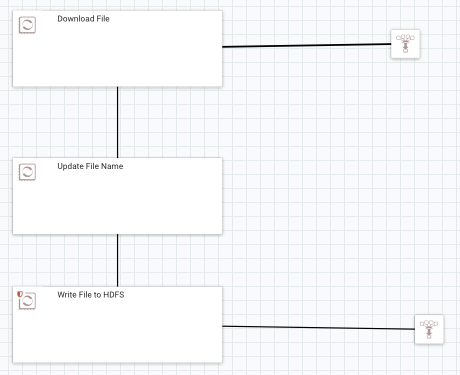
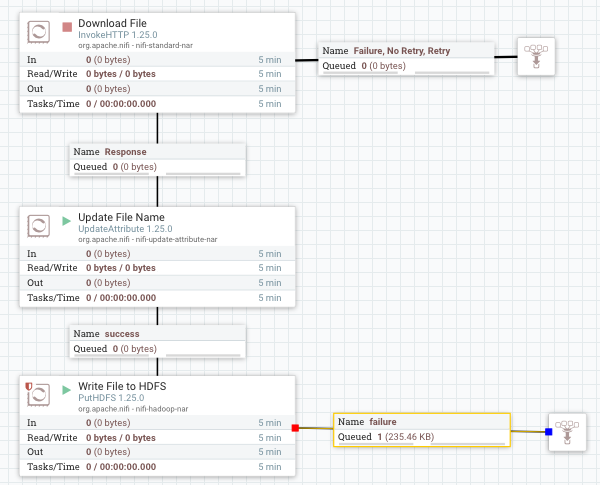
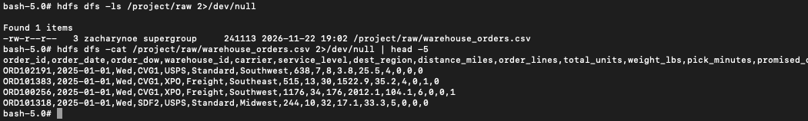

# NiFi: Loading the Dataset into HDFS

NiFi is the first step in the pipeline. It downloads my dataset from GitHub and writes it into HDFS so Hive can pick it up. I used the `Final_Project.json` template from the course and set it up for my own file through the Parameter Context, so the processors themselves didn't need to change.

## Dataset

**File:** `warehouse_orders.csv`  
**Raw GitHub URL:** https://raw.githubusercontent.com/NoeZach/warehouse-late-shipment-pipeline/main/sample-data/warehouse_orders.csv

The dataset is 3,000 outbound warehouse orders from 2025, shipped out of four warehouses by five different carriers. Each row has details about the order (lines, units, weight, pick time), how it shipped (carrier, service level, region, distance, promised transit days), whether it was peak season or had an inventory shortage, and whether it ended up being late. I work in warehouse operations, so I wanted a dataset that matched a problem I actually see, which is figuring out which orders are going to miss their delivery date. I generated the data myself with [`generate_orders.py`](../sample-data/generate_orders.py), so there's no real customer or company information in it.

## Processors

| Processor | Type | What it does |
|---|---|---|
| Download File | InvokeHTTP | Sends a GET request to the raw GitHub URL and passes the CSV along as a FlowFile. Failures and retries go to a funnel so I can see them in a queue. |
| Update File Name | UpdateAttribute | InvokeHTTP gives the file a random name, so this sets the `filename` attribute to `warehouse_orders.csv`. |
| Write File to HDFS | PutHDFS | Writes the file into the HDFS folder using the cluster's `core-site.xml`. If the file already exists it fails instead of overwriting it. |

The parameters I set were:

| Parameter | Value |
|---|---|
| DOWNLOAD FILE URL | the raw GitHub URL above |
| FILENAME | `warehouse_orders.csv` |
| HDFS WRITE DIRECTORY | `/project/raw` |
| USER | my VM username (from `whoami`) |

The flow is a straight line: download the file, rename it, write it to HDFS. I ran Download File with **Run Once** instead of starting it, because the template has it on a 60 second timer, and a second download would fail in PutHDFS since the file would already be there.

## HDFS Destination

**HDFS path:** `/project/raw/warehouse_orders.csv`

After the file landed in HDFS, I stopped NiFi to free up memory on the VM before moving on to Hive, Spark and HBase.

## Screenshots

### NiFi flow

### Flow running with data in the queue

This screenshot was taken after a second test run of Download File. The file was already in HDFS from the first run, so PutHDFS rejected the duplicate and sent it to the failure queue (that's the `1 (235.46 KB)` shown there). This is the "fail" conflict setting doing its job, since it keeps the file in HDFS from being overwritten. After this I switched to Run Once only.

### HDFS verification

The `hdfs dfs -ls /project/raw` output shows `warehouse_orders.csv` in HDFS, and the `head` output shows the header and the first few rows came through correctly.
