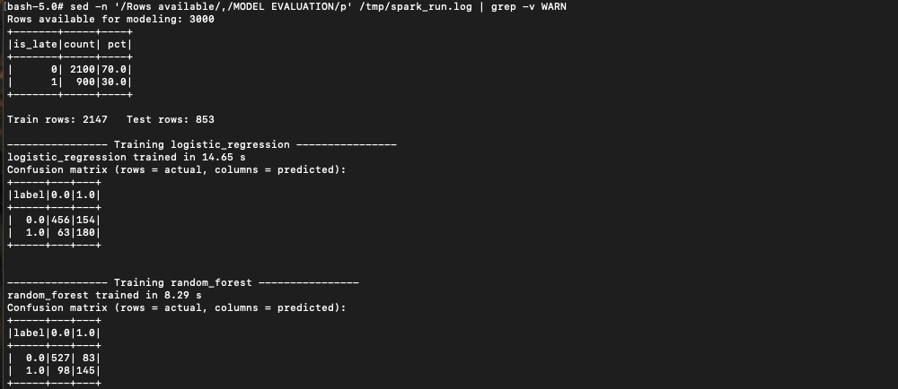
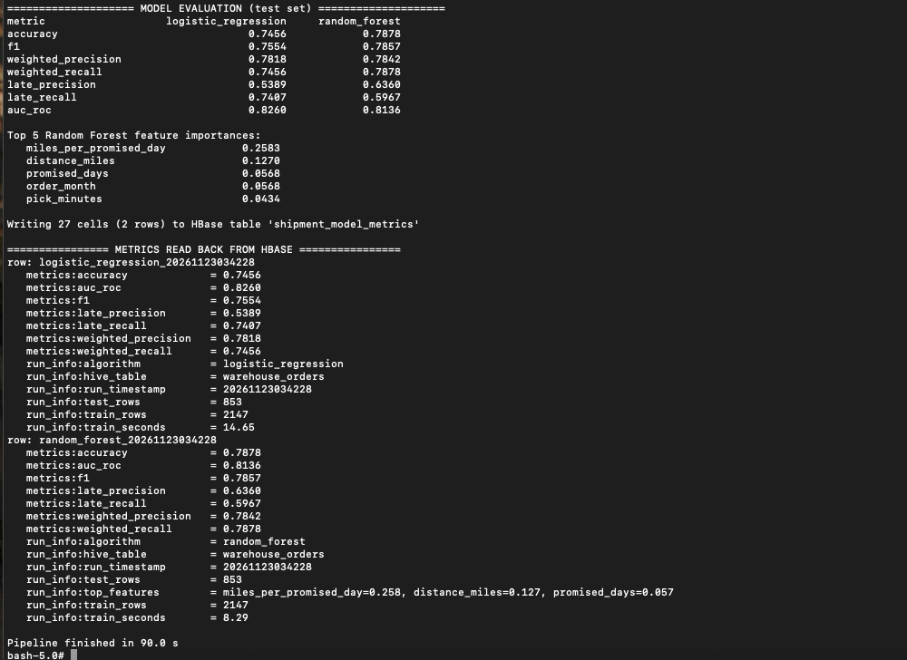
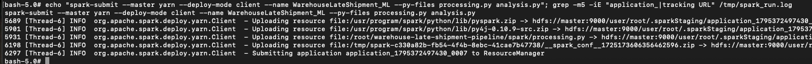

# Spark MLlib: Predicting Late Orders

This is the machine learning part of the pipeline. The PySpark job reads the Hive table, prepares the data, trains two models to predict whether an order will be late, evaluates them, and then writes the results into HBase. It runs on the cluster through YARN with `spark-submit`.

I split the code into two files:

- [`processing.py`](processing.py) loads the data from Hive, cleans it, adds features and builds the MLlib feature steps.
- [`analysis.py`](analysis.py) trains and evaluates the models and writes the metrics to HBase.

## Input from Hive

Spark connects to Hive with `enableHiveSupport()` and reads all 16 columns from `warehouse_orders`. The label is `is_late`, and the other columns (except `order_id` and the raw date) are used as features.

## Data Preparation

1. **Removing the header row.** Hive skips the CSV header because of the table setting, but Spark ignores that setting, so the header showed up as a row full of nulls. I filter out the row where `order_id` is literally `order_id` and then drop any rows with missing values.
2. **New features.** I added three columns: `order_month` (taken from the date, for seasonality), `units_per_line` (how bulky each line is), and `miles_per_promised_day` (distance divided by promised days, which measures how tight the delivery promise is).
3. **Class weights.** Only about 30% of the orders are late, so the models tended to just predict "on time" most of the time. I added a weight column so late orders count more during training.
4. **Encoding.** The five text columns go through `StringIndexer` and then `OneHotEncoder`.
5. **Feature vector.** `VectorAssembler` combines everything into one `features` column.
6. **Split.** 70% of the rows go to training and 30% to testing, with a fixed seed so reruns are comparable.

All of these steps and the model are in one MLlib `Pipeline`, so the same transformations get applied to the training and test data.

## Algorithms

**Random Forest** (main model) and **Logistic Regression** (baseline)

Since the question is late or not late, this is a classification problem, so I used classifiers instead of the linear regression from the walkthrough. I went with Random Forest as the main model because the things that cause late orders depend on each other. For example, a long distance is only a problem if the promised window is short, and one warehouse only struggles during peak season. Decision trees can pick up on those combinations on their own, and Random Forest also tells you which features mattered most. I trained Logistic Regression on the same features as a simpler model to compare against, so I could see whether the Random Forest was actually worth it.

## Evaluation

Both models are scored on the 30% test set using:

- **Accuracy:** the share of orders predicted correctly
- **F1, weighted precision and weighted recall:** overall precision and recall across both classes
- **Late precision:** of the orders predicted late, how many really were late
- **Late recall:** of the orders that really were late, how many the model caught
- **ROC AUC:** how well the model ranks risky orders above safe ones (0.5 is a coin flip)

I added late precision and late recall because accuracy alone can look good even if the model misses most late orders. The job also prints a confusion matrix for each model and the top Random Forest features.

### Training output



### Evaluation metrics



## spark-submit

```bash
cd ~/warehouse-late-shipment-pipeline/spark
spark-submit \
  --master yarn \
  --deploy-mode client \
  --name WarehouseLateShipment_ML \
  --py-files processing.py \
  analysis.py
```

`--master yarn` sends the job to YARN, which runs the executors on the worker containers. Client mode keeps the driver on the master container, so the output prints in my terminal. `--py-files processing.py` sends my helper file to the executors, since otherwise they can't import it.



## Writing to HBase

After evaluation, the job creates one HBase row per model with the row key `<model>_<timestamp>`. The `metrics` column family holds the scores above, and the `run_info` column family holds the algorithm name, the Hive table, the train and test row counts, the training time and the top features. The write uses the same `foreachPartition` pattern as the course example, where each executor connects to the HBase Thrift server with happybase. At the end, the job reads both rows back from HBase and prints them to confirm they were saved.
